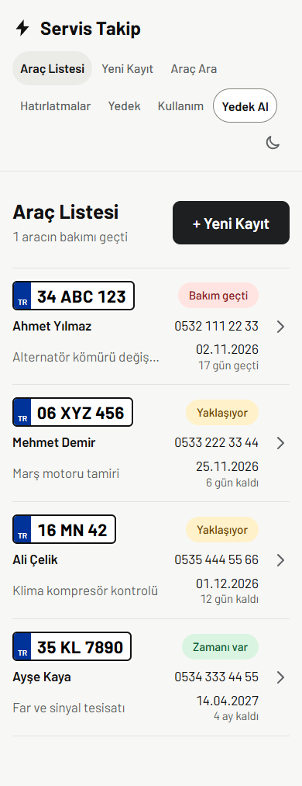
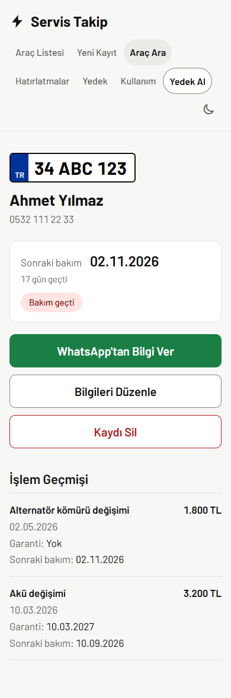
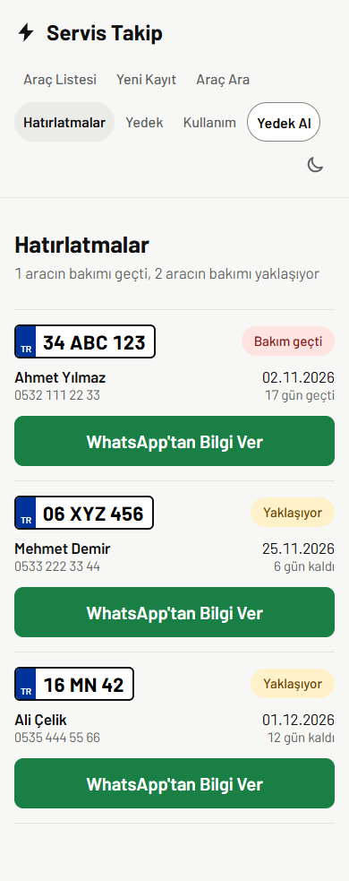
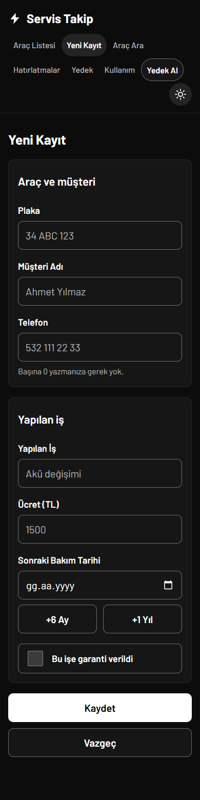

# Servis Takip

Bir oto elektrikçi ustası için yazılmış bakım takip uygulaması. Usta gelen aracı ve yapılan işi kaydeder, hangi aracın bakımının geçtiğini ya da yaklaştığını tek bakışta görür ve müşteriye WhatsApp'tan tek dokunuşla haber verir.

Proje gerçek bir kullanıcı için yapıldı. Telefon sürümü Kasım 2026'da ustanın iPhone'unda bir haftalık denemeye girdi.

<p align="center">
  
  
  
  
</p>

Ekran görüntülerindeki bütün isimler, plakalar ve telefon numaraları uydurmadır.

## Ne yapar

- Araç ve işlem kaydı: plaka, müşteri, telefon, yapılan iş, ücret, isteğe bağlı garanti ve sonraki bakım tarihi.
- Bakım durumu: geçen bakım kırmızı, 14 gün içinde gelecek bakım sarı, bakımına daha zaman olan yeşil. Liste en acil araçtan başlar.
- WhatsApp ile haber verme: müşterinin adı, plaka ve bakım tarihiyle hazır yazılmış mesaj açılır. Göndermeyi usta yapar.
- Plaka ile arama: plakanın bir parçası yeterli; boşluk ve büyük-küçük harf farkı aramayı etkilemez.
- Yedekleme: masaüstü sürümünde her kayıttan sonra otomatik yedek, iki sürümde de elle yedek alma.
- Açık ve koyu tema.

## Tasarım kararları

- **Sanayi ortamına göre arayüz.** Ana butonlar ve giriş kutuları en az 56, menü öğeleri 44 piksel yüksekliğinde; yazılar büyük, kontrast yüksek. Renk durum rozetlerine, plakaya ve ana eylemlere ayrılır; geri kalan her şey nötr tondadır.
- **Sıfır işletme maliyeti.** Ücretli sunucu ya da ücretli servis yok. Veri ustanın kendi cihazında durur.
- **Veri kaybına karşı önlem.** Masaüstü sürümünde veritabanı her değişiklikte Google Drive ya da OneDrive senkron klasörüne kopyalanır; buluta yüklemeyi o klasörün kendi programı yapar. Son yedek başarısızsa üst barda uyarı çıkar.
- **Türk plakasına özgü kurallar.** Plakalar tek biçimde saklanır (`34 ABC 123`). Türkçe klavyedeki noktalı `İ`, plakadaki `I` olarak okunur. Dükkan sürümünde eski kayıtlardaki aynı aracın boşluklu ve boşluksuz kopyaları açılışta birleştirilir.
- **Takvim günüyle hesap.** Kalan gün saatten etkilenmez. Bakım bugünse durum günün her saatinde "Yaklaşıyor" olur; bu kural Faz 2 testleriyle korunur.

## Fazlar

Proje aşamalı geliştirildi. Her faz kendi klasöründe duruyor; böylece gelişim adım adım izlenebiliyor.

| Klasör | İçerik | Teknoloji |
| --- | --- | --- |
| [`faz1-statik`](faz1-statik) | Ekranların hareketsiz taslakları | HTML, CSS |
| [`faz2-typescript`](faz2-typescript) | Veri tipleri, bakım durumu, biçimleme, arama ve testleri | TypeScript |
| [`faz3-nextjs`](faz3-nextjs) | Dükkan bilgisayarında çalışan canlı uygulama, yerel veritabanı ve otomatik yedek | Next.js, React, SQLite (`better-sqlite3`) |
| [`faz4-telefon`](faz4-telefon) | Telefon için yapılmış, sunucusuz ve internetsiz açılabilen sürüm | Next.js statik dışa aktarım, IndexedDB, Service Worker |

### Faz 3: dükkan sürümü

- Yalnızca `127.0.0.1` üzerinde dinler; ağa açılmaz.
- Veri tek bir SQLite dosyasında durur. Yeni kayıtta araç bilgisi ile işlem tek bir transaction içinde yazılır.
- Plaka değişikliği aracın bütün işlem geçmişini yeni plakaya taşır; ya tamamen olur ya hiç olmaz.
- Form kuralları sunucu tarafında da denetlenir.
- Telefon sürümünden alınan yedeği veritabanına aktaran bir komut satırı aracı içerir. Araç önce yalnızca rapor verir, yazmadan önce veritabanının kopyasını alır ve çakışan plaka varsa hiçbir şey yazmaz.

### Faz 4: telefon sürümü

- Sunucusuz çalışır; derlenen dosyalar herhangi bir statik barındırmaya yüklenebilir.
- Kayıtlar telefonun tarayıcı deposunda (IndexedDB) tek bir belge olarak durur. Her değişiklik saf bir fonksiyonla yapılır, bu yüzden kolay test edilir.
- Ana ekrana eklenince tam ekran açılır. Sürümlü bir Service Worker sayfaları önbellekten açar; yeni sürüm ancak eski sayfalar kapanınca devreye girer ve eski önbelleği siler.
- Yedek, iPhone paylaş menüsüyle dosya olarak dışarı alınır. Geri yüklemede neyin silineceği gösterilir ve onay istenir.
- Plaka adresin `#` sonrasında taşınır; sunucuya gitmez.
- Sayfalar arama motorlarına kapalıdır (`noindex, nofollow`).

## Test

Faz 3 ve Faz 4 testleri Node.js'in yerleşik test koşucusuyla yazıldı; ek test kütüphanesi yok. Faz 2'nin kendi küçük test betiği var.

- `faz4-telefon`: 129 test
- `faz3-nextjs`: 57 test

Faz 3 testleri geçici bir klasördeki ayrı bir veritabanıyla çalışır. Veritabanı yolu proje klasörünün içindeyse testler başlamayı reddeder; böylece gerçek müşteri verisine dokunulmaz.

## Çalıştırma

Node.js 24 veya üstü gerekir.

Telefon sürümü:

```bash
cd faz4-telefon
npm install
npm run dev
```

Derleme `npm run build` ile yapılır; çıktı `faz4-telefon/out` klasörüne yazılır.

Dükkan sürümü:

```bash
cd faz3-nextjs
npm install
npm run dev
```

Ayarlar için `faz3-nextjs/.env.example` dosyasını `.env.local` adıyla kopyala. `YEDEK_KLASORU` otomatik yedeğin yazılacağı klasördür. `SERVIS_ORNEK_VERI=1` boş veritabanını denemek için örnek araçlarla doldurur; gerçek kullanımda boş kalmalıdır.

Testler `faz2-typescript`, `faz3-nextjs` ve `faz4-telefon` klasörlerinde `npm test` ile çalışır.

## Güvenlik ve gizlilik

- Veritabanı, yedek dosyaları ve gerçek ayar dosyaları `.gitignore` ile depo dışında tutulur.
- Her commit'ten önce değişiklikler [gitleaks](https://github.com/gitleaks/gitleaks) ile taranır (`.githooks/pre-commit`). Araç kurulu değilse commit durur, sessizce geçmez. Yeni bir klonda kancayı etkinleştirmek için: `git config core.hooksPath .githooks`
- Projede dış API ve API anahtarı yok. İleride eklenirse uyulacak kurallar [`SECURITY.md`](SECURITY.md) dosyasında yazılı.

## Yapay zekâ ile geliştirme süreci

Bu proje yapay zekâ kodlama ajanlarıyla (Claude Code ve yardımcı modeller) geliştirildi. Kararları, kapsamı ve onayı ben verdim; ajanlar yazılı kurallar içinde çalıştı.

- Kurallar [`CLAUDE.md`](CLAUDE.md) ve [`AGENT.md`](AGENT.md) dosyalarında aynen tutulur: gerçek API anahtarı asla okunmaz ya da yazılmaz, `.env` yerine yalnızca `.env.example` oluşturulur, geri alınamaz işlemlerden önce onay istenir.
- Her faz bitince duruldu; onaysız sonraki faza geçilmedi.
- Her önemli işten sonra işi yapmayan ayrı bir oturum bağımsız denetim yaptı. Bulgular ayrı commit'lerde düzeltildi.
- `.claude/settings.json` ajanın gizli ayar dosyalarını okumasını engelleyen bir yasak listesi içerir.
- Yarım kalan işler [`backlog.md`](backlog.md) dosyasında tutulur.

## Bilinen sınırlar

- Ekran bileşenlerinin otomatik testi yok; testler veri katmanını, istek işleyicilerini, yedeklemeyi ve aktarım aracını kapsar.
- Telefon sürümünde internetsiz kullanım ilk açılışta kendiliğinden hazır olmuyor; uygulamanın internet açıkken birkaç kez açılması gerekiyor ve hazır olup olmadığı ekranda gösterilmiyor.
- Faz 3 veritabanında araç ile işlem arasındaki bağ denetimi (foreign key) açık değil; bu şu an uygulama akışıyla sağlanıyor.
